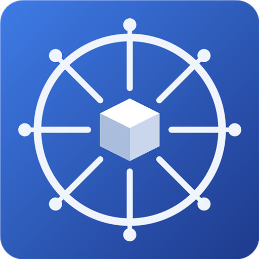
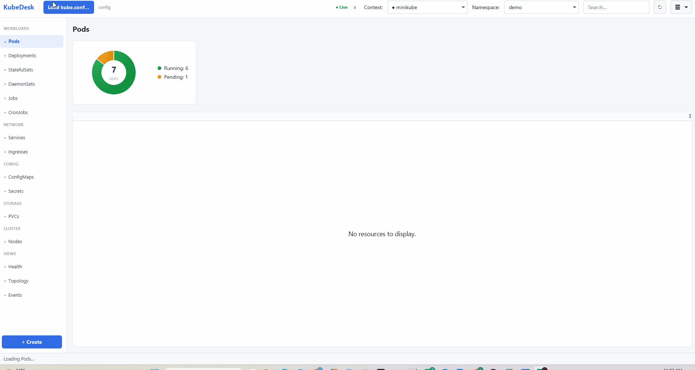
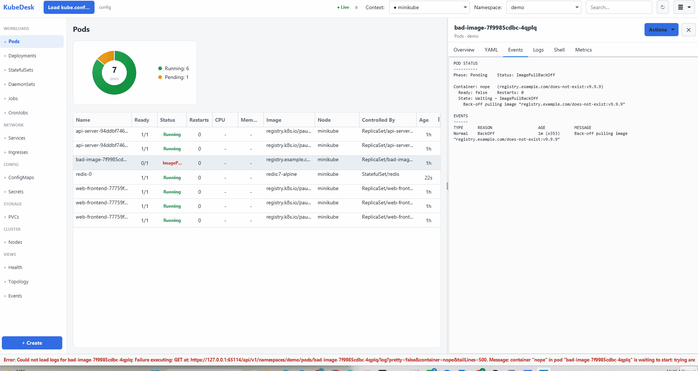

<div align="center">



# KubeDesk

**Your `kubectl`, without the terminal.**
A lightweight, cross-platform desktop GUI for Kubernetes — talks straight to the cluster API, no `kubectl` binary required.

[](https://github.com/ysrgozudeli/kubedesk/releases/latest)
[](https://github.com/ysrgozudeli/kubedesk/releases)
[](LICENSE)
[](https://github.com/ysrgozudeli/kubedesk/stargazers)


### [⬇️ Download for Windows · macOS · Linux](https://github.com/ysrgozudeli/kubedesk/releases/latest)



</div>

---

KubeDesk connects with **any** `kube.conf` and talks **directly to the cluster API server** (via the
[fabric8 Kubernetes client]) using your existing credentials — **no `kubectl` binary needed** for any
operation. The UI deliberately mirrors the official Kubernetes Dashboard so anyone coming from there
feels at home, positioned as a **lighter, free alternative to Lens**.

- 🖥️ **Desktop-native** — a self-contained app that bundles its own Java runtime. Your users don't install Java, kubectl, or anything else.
- 🔌 **No kubectl required** — every read and action goes over the API. (There's an *optional* embedded kubectl console for the long tail — and it works even without kubectl on your PATH.)
- 🔍 **See your cluster** — live resource tables, a real dependency **topology map**, a one-screen **health scan**, and live **CPU/memory** charts.
- 🛠️ **Act safely** — delete, restart, scale, exec, port-forward, and apply YAML with **dry-run validation** — all with confirmations.
- ⌨️ **Move fast** — a **command palette** (`Ctrl`/`Cmd`+`P`) to jump to any cluster, namespace, resource kind, or view without the mouse.
- 🗂️ **Juggle many clusters** — a **cluster rail** of colored avatars (across several kube.conf files), an **environment** tag per cluster (`DEV`/`STAGING`/`PROD`, auto-detected) that color-codes it, and a per-cluster **Overview** dashboard.
- 🧳 **Runs anywhere** — including a **portable zip** for locked-down machines (VDIs) where you can't run an installer.

## ✨ In action

The hero above: **load a kubeconfig and browse a cluster live** — contexts, namespaces, and 12
resource kinds in Dashboard-style tables with status chips and live watches.

**Inspect a pod without the terminal** — stream logs and open an interactive shell straight from the
details panel (Overview / YAML / Events / Logs / Shell tabs), all over the API.

<p align="center"></p>

## 🚀 Install

**The easy way — [download a prebuilt package from the latest release](https://github.com/ysrgozudeli/kubedesk/releases/latest).** No Java, no kubectl.

| Platform | Download |
|----------|----------|
| **Windows** | `.msi` installer, or the **portable `.zip`** (no installer / no admin — ideal for VDIs: unzip and run `KubeDesk.exe`) |
| **macOS** | `.dmg` |
| **Linux** | `.deb` or `.rpm` |

> Installers are **unsigned**, so Windows SmartScreen ("unknown publisher") and macOS Gatekeeper will
> warn on first launch. On Windows: *More info → Run anyway*. On macOS: right-click the app → *Open*.

Prefer to build it yourself? See [Build from source](#-build-from-source).

## 🧭 What it does

### Browse
- Load **any** `kube.conf` file (file picker) — not just `~/.kube/config`.
- Browse **contexts** and **namespaces** from the chosen config.
- **12 resource kinds** in the sidebar: Pods, Deployments, StatefulSets, DaemonSets, Jobs, CronJobs,
  Services, Ingresses, ConfigMaps, Secrets, PVCs, Nodes — Dashboard-style tables with status chips.
- **Live updates** via watches, with **pause/resume**.
- **Command palette** (`Ctrl`/`Cmd`+`P`) — a keyboard-driven quick-switcher: type to fuzzily filter
  across contexts, namespaces, resource kinds, and views, then ↑/↓ and `Enter` to jump there.
- Client-side **search/filter** and per-kind **column show/hide** (persisted).
- Extra pod columns: **CPU / Memory** (Metrics API, degrades gracefully without metrics-server),
  **IP**, **QoS class**, and **Controlled By**.

### Inspect
- **Details panel** with per-kind tabs: **Overview / YAML / Events / Logs / Shell**.
- **Pod failure diagnostics** — container state, exit codes, and eviction reasons (surfaces *why* a
  pod is failing even after its events have expired).
- **Live pod metrics** (pod → **Metrics** tab): live CPU/Memory line charts polled from the Metrics
  API — a quick read on whether a pod is climbing toward its limits.
- **Live log follow** (`kubectl logs -f`) — a **▶ / ⏸** button on the Logs tab streams new lines as
  they arrive, and keeps following as you switch between pods (great for watching a rollout). Scroll up
  to read and it stops auto-scrolling (a **↓ Jump to latest** pill re-pins you to the newest line).
  Plus **filter lines**, a **Previous** toggle for the prior crashed container's logs
  (`kubectl logs --previous`), **Timestamps**, wrap, clear, and a pod-status dot.
- **Detachable log window** — **⧉ Detach** pops a pod's logs into its own window that keeps streaming
  while you work elsewhere; open several at once to watch multiple pods side by side.
- **Log save-to-file** and a resizable details split.

### Views
- **Topology** — a native, dependency-free **Ingress → Service → Workload → Pods** map with the *real*
  edges (Service→Pod by label selector, Deployment→Pod by ownership via ReplicaSet). Click a node to
  focus + open details in place, click a line to trace a connection, drag to pan, Ctrl+scroll to zoom.
- **Health scan** — one screen of "what's wrong right now": CrashLoop / ImagePull / OOM / Evicted /
  unschedulable / high-restart / BestEffort pods, unavailable workloads, failed Jobs, unbound PVCs,
  orphaned Services, and unhealthy / cordoned Nodes. Ranked most-severe first; double-click to inspect,
  right-click to act.
- **Events view** — the namespace event stream as a table (Type, Reason, Object, Count, Last Seen,
  Message), most-recent first, Warnings tinted — the practical "namespace log."

### Act (all over the API — no kubectl)
- **Management actions**: delete, rollout restart, scale, and edit-YAML-and-apply — with confirmations
  and per-kind context menus, reachable from table rows, topology nodes, and the details **Actions** menu.
- **Restart a pod** — **Restart (recreate)** on any controller-managed pod deletes it and lets its
  ReplicaSet/StatefulSet/DaemonSet/Job spin up a fresh one (Kubernetes has no in-place pod restart). Bare
  pods don't get the option, since nothing would bring them back.
- **"+ Create / Apply YAML"** — create or update any resource(s) via server-side apply (multi-document,
  open-from-file), with **live YAML linting** and a **Validate (dry-run)** button.
- **Pod exec** command console.
- **Port-forwarding** — open a tunnel to a pod port at `localhost:<port>`; a toolbar manager lists
  active tunnels (Copy / Open / Stop). Tunnels are persisted and offered for restore on next launch.
- **Embedded kubectl console** (☰ menu, or **Ctrl/Cmd+K**) — a terminal drawer that runs *your own*
  `kubectl` with the active context/namespace/kubeconfig auto-injected. Live streaming output with a
  **Stop** button, **↑/↓** history, and shell pipes/redirects (`| grep`, `| jq`, `> file`). A
  command-runner, not a full TTY (use the pod **Shell** tab for `exec -it`). It's the only feature that
  uses a local kubectl — and it resolves one next to the app or via `KUBEDESK_KUBECTL`, so it works even
  when kubectl isn't on your PATH.

### Preferences & updates
- **Persisted** across restarts (`~/.kubedesk/prefs.json`): custom kube.conf path, last context and
  namespace, hidden columns, and active port-forwards.
- **Auto-update** — on startup KubeDesk checks GitHub for a newer release and offers a one-click in-app
  update. Also under **☰ → Check for updates**. Disable with `updateCheckEnabled: false` in prefs.

## 🏗️ Architecture

The UI never touches fabric8 directly. Everything goes through the single `ClusterService` interface,
so a future `kubectl`-backed implementation can be added without changing the UI — and the experimental
**[MCP server](#-mcp-server-for-ai-agents-experimental)** reuses that very same interface directly. A
generic table model (columns + string rows) drives all kinds.

```
JavaFX UI  ──►  ClusterService  ──►  Fabric8ClusterService  ──HTTPS/WSS──►  cluster API server
```

## 🤖 MCP server for AI agents (experimental)

> 🧪 **Experimental — dev/testing use only, not for production.** It gives an AI agent read access to
> your cluster using your kubeconfig credentials. It binds **loopback only** (`127.0.0.1`) and is
> **off by default**.

KubeDesk can expose a small embedded, **read-only** [Model Context Protocol](https://modelcontextprotocol.io)
server that reuses the same `ClusterService` the UI uses — so an AI agent (e.g. Claude) can inspect your
cluster over the API, **no `kubectl` required**. It speaks Streamable HTTP, so any MCP client can connect.

- **Turn it on:** ☰ menu → **MCP server…** → flip the switch. It serves `http://127.0.0.1:<port>/mcp`
  (default `7865`) and keeps running until you switch it off or quit KubeDesk.
- **Connect an agent** (Claude Code):
  ```bash
  claude mcp add --transport http kubedesk http://127.0.0.1:7865/mcp
  ```
  then ask it something like *"scan my cluster's health."*
- **Tools (all read-only):** `health_scan`, `list_namespaces`, `list_resource`, `describe_yaml`,
  `pod_logs`. Context and namespace default to whatever is selected in KubeDesk, and results are kept
  compact (server-side filters, capped log tails) to save the agent's tokens. `describe_yaml` **redacts
  Secret values** (`data`/`stringData` → `<redacted>`, keys kept) so the agent never receives secret
  material — the UI's own YAML view is unchanged.
- **Watch it work (live UI mirror).** When the agent calls a read tool, KubeDesk reflects it in the
  running window: a `🤖 agent · …` line in the status bar and, with **Follow agent** on (default), it
  switches namespace/kind and opens the resource's **YAML** or **Logs** tab so you see what the agent
  read. The MCP panel carries a `READ-ONLY` badge and a live **Recent activity** list.

Write actions (behind an in-UI confirmation so you stay the hand that acts) are planned but **not here
yet** — see the roadmap. Today an agent helps with changes by producing ready-to-apply YAML and pointing
you at the **+ Create** button (or a resource's **YAML → Apply**).

## 🛠️ Build from source

Requires a **JDK 21** with `JAVA_HOME` set.

```bash
# Run in development
mvn javafx:run

# Or build a runnable fat jar
mvn package
java -jar target/kubedesk.jar
```

## 📦 Package a native app (jpackage)

KubeDesk ships as a self-contained app that **bundles its own Java runtime** — end users do **not** need
Java installed. Packaging uses the JDK's `jpackage`, so you need a **JDK 17+** (we use 21) with
`JAVA_HOME` set.

> `jpackage` **cannot cross-compile** — build each platform's package **on that platform** (Windows →
> `.exe`/`.msi`, macOS → `.dmg`/`.pkg`, Linux → `.deb`/`.rpm`). The recommended way to produce all three
> is the CI matrix (see [Releases](#-releases-ci)).

Convenience scripts do the work: **`scripts/package.ps1`** (Windows) and **`scripts/package.sh`**
(macOS/Linux). Both build the fat jar, stage it, and invoke `jpackage`.

### Windows (`.exe` / `.msi`)

```powershell
# Self-contained app folder — no extra tooling. -> dist\KubeDesk\KubeDesk.exe
./scripts/package.ps1

# Portable zip — no installer, no admin, no Java. Unzip and run KubeDesk.exe.
# Ideal for locked-down machines (e.g. a VDI).
./scripts/package.ps1 -Zip          # -> dist\KubeDesk-1.12.0-windows-portable.zip

# Installer (.exe or .msi) — requires the WiX Toolset v3 on PATH.
./scripts/package.ps1 -Type exe     # -> dist\KubeDesk-1.12.0.exe
./scripts/package.ps1 -Type msi     # -> dist\KubeDesk-1.12.0.msi
```

Installers (`exe`/`msi`) need the **[WiX Toolset v3](https://wixtoolset.org/)** on the `PATH`:

```powershell
winget install --id WiXToolset.WiXToolset    # or download the v3 installer from wixtoolset.org
```

The installer adds a Start-menu entry, a desktop shortcut, and an install-location chooser.

### macOS (`.dmg` / `.pkg`)

```bash
chmod +x scripts/package.sh          # once
./scripts/package.sh                  # app-image -> dist/KubeDesk.app
./scripts/package.sh dmg              # -> dist/KubeDesk-1.12.0.dmg
./scripts/package.sh pkg              # -> dist/KubeDesk-1.12.0.pkg
```

Needs **Xcode Command Line Tools** (`xcode-select --install`). For distribution *outside* your own
machines, macOS requires the app to be **code-signed and notarized** with an Apple Developer ID. Pass
signing options to jpackage (`--mac-sign --mac-signing-key-user-name ...`) once you have a certificate.

### Linux (`.deb` / `.rpm`)

```bash
chmod +x scripts/package.sh          # once
./scripts/package.sh                  # app-image -> dist/KubeDesk/
./scripts/package.sh deb              # -> dist/kubedesk_1.12.0_amd64.deb   (needs dpkg + fakeroot)
./scripts/package.sh rpm              # -> dist/kubedesk-1.12.0.x86_64.rpm  (needs rpmbuild)
```

- `.deb` needs `dpkg-deb` + `fakeroot` (`sudo apt install fakeroot`).
- `.rpm` needs `rpmbuild` (`sudo dnf install rpm-build`).

### App icon (optional, per OS)

Drop a platform icon and the scripts pick it up automatically:

| OS      | File                                          |
|---------|-----------------------------------------------|
| Windows | `src/main/resources/icons/kubedesk.ico`       |
| macOS   | `src/main/resources/icons/kubedesk.icns`      |
| Linux   | `src/main/resources/icons/kubedesk.png`       |

### Notes

- The **app-image** is the simplest artifact (~174 MB, bundles the JRE). Zip `dist/KubeDesk/` to hand
  someone a runnable app with no installer.
- To shrink the bundle, a custom `jlink` runtime (only the modules KubeDesk uses) can roughly halve the
  size — verify TLS/auth still work afterward.

## 🚢 Releases (CI)

A GitHub Actions workflow (`.github/workflows/release.yml`) builds native installers for all three
platforms on their own runners (jpackage can't cross-compile):

| Platform | Artifact                              |
|----------|---------------------------------------|
| Windows  | `.msi` (WiX) **+ portable `.zip`**     |
| macOS    | `.dmg`                                 |
| Linux    | `.deb` and `.rpm`                      |

**Cut a release:**

```bash
git tag v1.12.0
git push origin v1.12.0
```

Pushing a `v*` tag builds every installer and publishes a **GitHub Release** with them attached (using
the matching [CHANGELOG](CHANGELOG.md) section as the release body). You can also trigger the workflow
manually from the **Actions** tab — manual runs upload the installers as **workflow artifacts** instead
of creating a release.

## 🗺️ Roadmap

Shipped through **v1.12.0**: 12 resource kinds, live watches, details panel (exec + logs + live
metrics), pod diagnostics, live log follow + detachable log windows, management actions (incl. pod
restart), Create/Apply with lint + dry-run, port-forwarding, topology view, health scan, Events view,
embedded kubectl console, a command palette, the experimental read-only **MCP server with a live UI
mirror**, and cross-platform native packaging.

Candidate next:
- **MCP server — write actions.** The read-only server and its live UI mirror already exist
  ([experimental, above](#-mcp-server-for-ai-agents-experimental)); next is **write tools behind an
  in-UI confirmation** so you stay the hand that acts.
- **All-namespaces view + global search.**
- **Multi-pod log tailing** (stern-style — one merged stream across a Deployment's pods; single-pod
  follow + detachable windows already shipped) and optional Loki/cloud-logging integration.
- **Headless health CLI** for CI/CD gates (reuses `ClusterService.healthCheck`).
- Sealed Secrets, generic CRD support, and macOS signing/notarization.

## 📖 Guides

> 📘 **User guide:**
> [**KubeDesk: A Free, Open-Source Desktop GUI for Kubernetes — Your kubectl Without the Terminal**](https://medium.com/@ysrgozudeli/kubedesk-a-free-open-source-desktop-gui-for-kubernetes-your-kubectl-without-the-terminal-ee9cd11ca25a)
> — a full walkthrough with screenshots.
>
> 📗 **New to Kubernetes?**
> [**Kubernetes for Spring Boot Microservice Developers: From Pods to Production**](https://medium.com/@ysrgozudeli/kubernetes-for-spring-boot-microservice-developers-from-pods-to-production-f9890aa432af)
> — a hands-on intro to Pods, Deployments, Services, and Ingress that uses KubeDesk to *see* it all running.

## 📄 License

[MIT](LICENSE) © Yasar Gozudeli

[fabric8 Kubernetes client]: https://github.com/fabric8io/kubernetes-client
[AtlantaFX]: https://github.com/mkpaz/atlantafx
